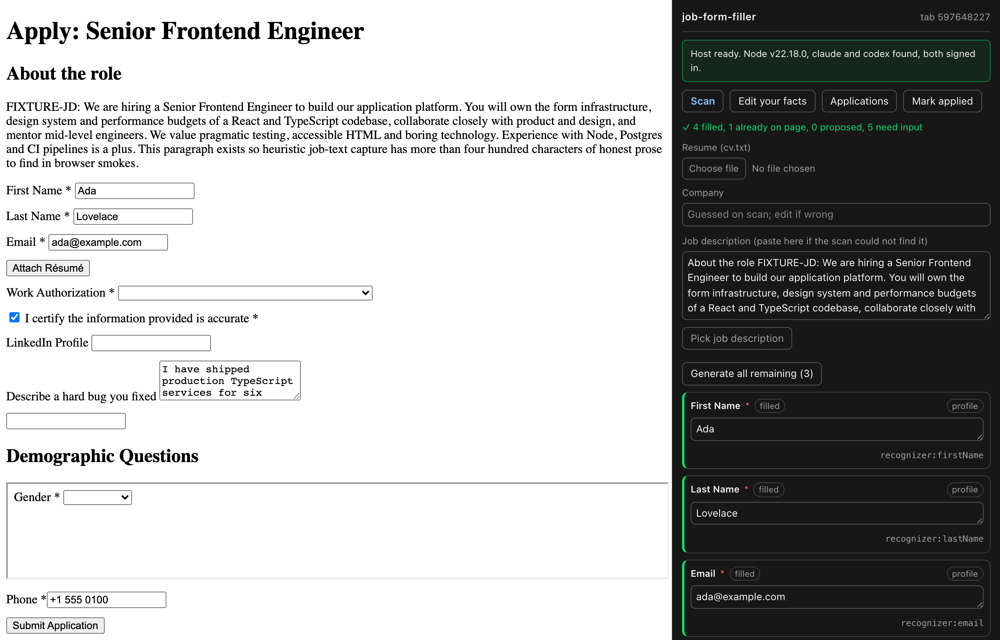
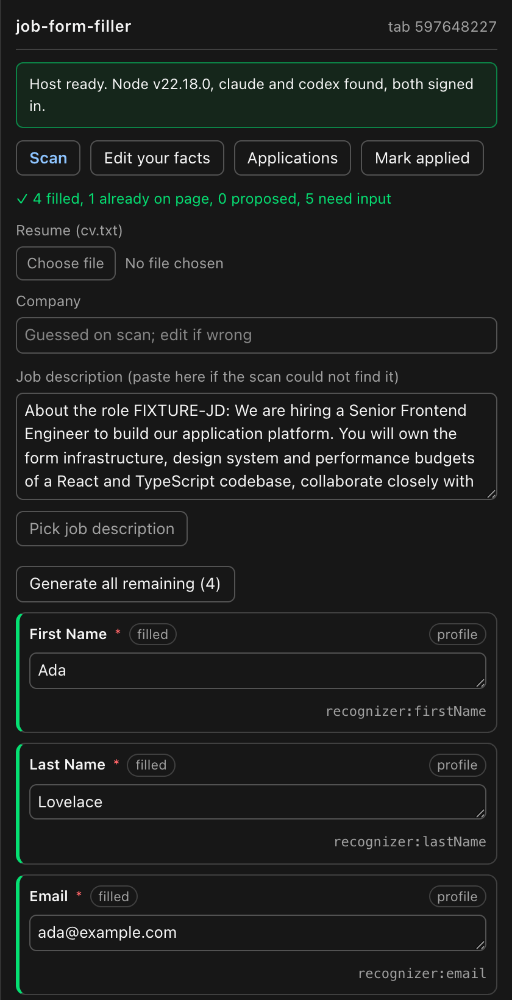
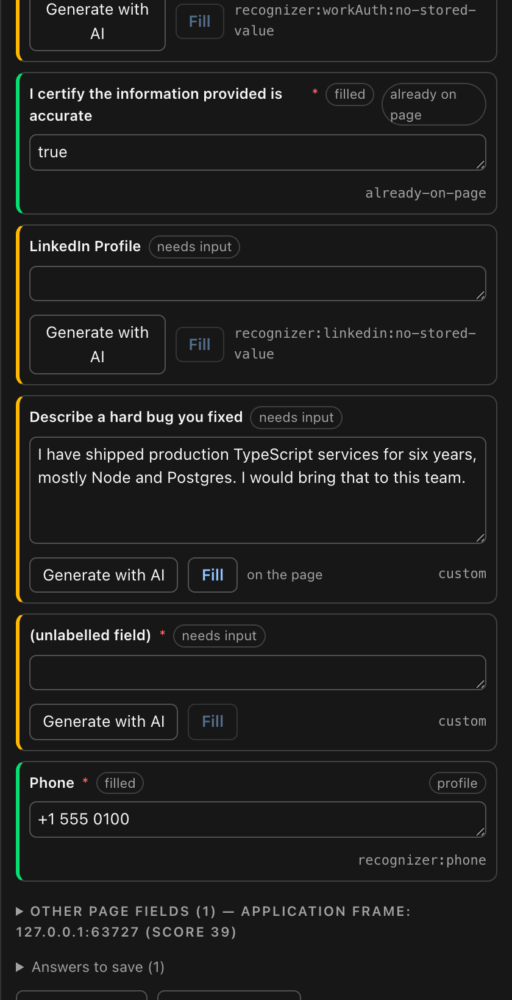
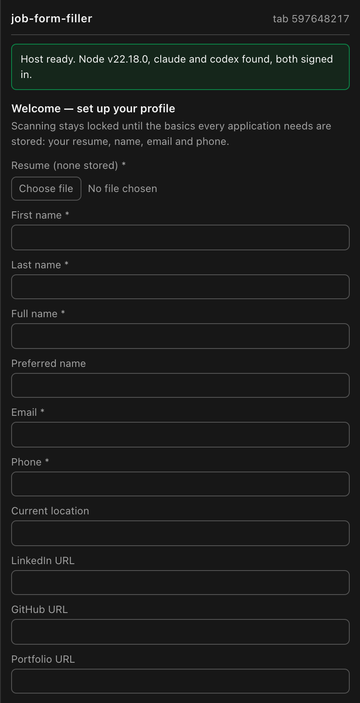
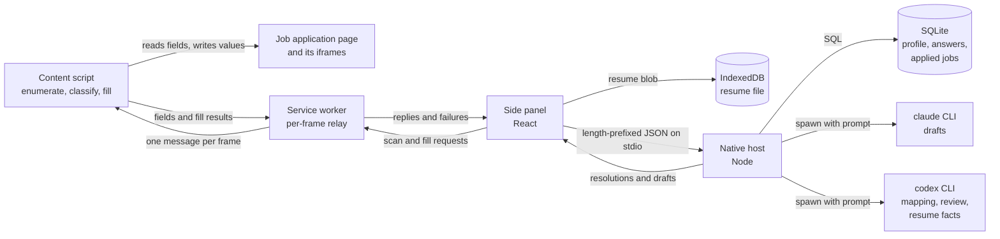

# job-form-filler

A Chrome extension and a local Node helper that read a job application form, fill it from answers you stored, and draft the free-text answers for you to edit. It never submits the form.

**Status: work in progress.** Today it scans, fills and saves on Greenhouse forms and Ashby-style embedded application frames, with an onboarding gate, per-tab sessions and a list of jobs you applied to. Per-ATS modules, an Ignore button with saved Captures, and the guard that keeps a Draft out of your profile facts are designed in [docs/specs](docs/specs/2026-09-03-per-ats-architecture-design.md) and not built yet.



## What it is

Job applications ask the same questions in a different layout on every site, then add a few free-text ones that take the longest. I built this to stop retyping my name, links, work authorization and notice period, and to get a first draft of the free-text answers that I can edit before anything reaches the page.

It is a personal tool, sideloaded into Chrome on macOS. The side panel scans the page, including forms inside iframes, and sorts every field into filled, proposed, needs input or skipped. Facts come only from what you stored: your profile, a bank of standing answers and the answers you saved on earlier applications. Each application you save makes the next one fill more.

For the questions nothing stored can answer, it spawns the `claude` CLI to write a Draft from the job description and your resume, then has the `codex` CLI review that Draft in the same request. You edit, click Fill, submit the form yourself and mark the job applied.

## What works today

- Block scanning until a resume, name, email and phone are stored. Evidence: `extension/src/panel/completeness.test.ts`, the onboarding test in `e2e/sessions.spec.ts`.
- Scan a page, pick the frame that holds the application and send only its fields on. Evidence: `extension/src/panel/election.test.ts`, `e2e/election.spec.ts` with a cross-origin iframe.
- Fill name, email, phone and other known facts from deterministic recognizers, with no model call. Evidence: `host/src/resolve/waterfall.test.ts`, and `e2e/full-loop.spec.ts` asserts the values on the page.
- Skip demographic and EEO questions and stop on an active CAPTCHA. Evidence: `extension/src/content/classify.test.ts`, the EEO and CAPTCHA tests in `e2e/foundation.spec.ts`.
- Draft a free-text answer, review it with a second model, and ship it with a warning when the review fails. Evidence: `host/src/llm/generate.test.ts`, `host/src/llm/reviewDraft.test.ts`.
- Fill text boxes, selects, radio-style choice buttons and type-to-search comboboxes, and check that the page kept a typed value before calling it filled. Evidence: `extension/src/content/fill.test.ts`, the react-select test in `e2e/foundation.spec.ts`.
- Save answers to SQLite and recall them on the next form. Evidence: `extension/src/panel/save.test.ts`, `host/src/db/repos.test.ts`, the save step of `e2e/full-loop.spec.ts`.
- Keep one session per tab across tab switches, wizard steps and panel reloads. Evidence: `extension/src/panel/sessions.test.ts`, `e2e/sessions.spec.ts`.
- Mark a job applied and show "Already applied on <date>" when you open it again. Evidence: the Mark applied and Revisit badge tests in `extension/src/panel/App.test.tsx`.
- Read a PDF resume as text without gluing words or splitting emails. Evidence: `extension/src/panel/cvText.test.ts`.

The suite is 866 unit tests in 53 files (`npm test`) and 17 browser tests in 5 files (`npm run smoke`).

### Next

From the [per-ATS architecture spec](docs/specs/2026-09-03-per-ats-architecture-design.md), in build order:

1. Profile write guard: a generated Draft can never be stored as a profile fact.
2. Panel state: the status line is derived from the session, and a scan that finds no fields always says so.
3. Serial choice fill: a combobox fill counts only when the page committed the option and closed its menu.
4. ATS identity and modules: Greenhouse and Ashby each get a module over one generic path.
5. Ignore and Captures: hide a wrong row for the session and save the page structure as evidence for the next fix.

## Look



After a scan. The green banner is the self-check: host reachable, both CLIs found and signed in. Below it, each row shows its value and where the value came from.



A drafted answer after Generate with AI and Fill. The text here comes from the fake `claude` in `e2e/bin`, which the screenshot run uses in place of a real model.



The onboarding gate. Scanning stays locked until the four required facts exist.

All four images on this page come from `npm run readme:shots`, which drives the repo's own fixture form in a throwaway Chromium profile. See [docs/readme/capture.spec.ts](docs/readme/capture.spec.ts).

## Run it

| Fact | Value |
| --- | --- |
| Runtime | Node 20 or newer (`.nvmrc` pins 20; checked here on 22.18.0) |
| Package manager | npm with workspaces (checked here on 11.7.0) |
| Operating system | macOS only: the installer writes Chrome's native-messaging manifest under `~/Library/Application Support/Google/Chrome` |
| Browser | Google Chrome, with the extension loaded unpacked |
| External services | The `claude` and `codex` CLIs, installed and signed in |
| Paid keys | No API key. The two CLIs run on whatever accounts they are signed in to |
| Ports | None. The extension talks to the helper over stdio; the browser tests bind a random localhost port |
| Time to first run | A few minutes for `npm i` and the build. Not timed on an idle machine |

1. Get the code.

```bash
git clone https://github.com/kevinshibuya/job-form-filler.git
cd job-form-filler
```

Expect: a `job-form-filler` directory with `package.json`, `host/`, `extension/` and `shared/`.

2. Install dependencies.

```bash
npm i
```

Expect: `added 384 packages`, and the native `better-sqlite3` module builds with no error.

3. Build the three workspaces.

```bash
npm run build
```

Expect: the last line is `✓ built in`, and `extension/dist/manifest.json` exists.

4. Register the native host with Chrome. It writes `~/.job-form-filler/config.json`, a wrapper script in `host/bin/`, and Chrome's manifest for `com.kevin.jobformfiller`. Run from a shell where `command -v claude` and `command -v codex` both print a path. This check ran it with `HOME` pointed at a scratch directory, so no real Chrome profile was touched.

```bash
npm run install-host -w @jff/host
```

Expect: `job-form-filler host installed.`, then the paths of node, claude, codex, the wrapper, the database and the Chrome manifest, and `extension   oigkjociebfhgldfhijgdilhijkeamfb`.

5. Load the extension. Quit Chrome fully and reopen it, since Chrome reads native-messaging manifests at startup. Open `chrome://extensions`, turn on Developer mode, click Load unpacked and pick `extension/dist`. Then open a job application and click the toolbar icon.

Not run here: this step needs a person at a real Chrome window, and this check stayed away from every real Chrome profile.

Expect: the extension card shows the id `oigkjociebfhgldfhijgdilhijkeamfb`, and the side panel shows `Host ready. Node v…, claude and codex found, both signed in.`

### Check it works

```bash
npm test
```

Expect: `Test Files  53 passed (53)` and `Tests  866 passed (866)`.

The browser tests need Playwright's Chromium once, then drive a headless Chromium with the extension and a real host process wired to fake CLIs:

```bash
npx playwright install chromium
npm run smoke
```

Expect: `17 passed`. The smoke run leaves a test build in `extension/dist`; run `npm run build` before loading the extension again.

### Environment variables

| Name | Required | What it does | How to get a value |
| --- | --- | --- | --- |
| `JFF_HOME` | Optional | Directory the host reads `config.json` from and keeps its database and log in. Default `~/.job-form-filler`. The installer ignores it | Any writable directory path |
| `JFF_TEST_SEAM` | Optional, build time | `1` builds the test seam the browser tests drive. Never use it for a real install | `1` or unset |
| `JFF_FAKE_CLAUDE_MODE` | Optional, tests only | Mode of the fake `claude` in `e2e/bin`: `ok`, `salary`, `not_authed`, `rate_limit`, `garbage` | One of those values |
| `JFF_FAKE_CODEX_MODE` | Optional, tests only | Mode of the fake `codex` in `e2e/bin`: `ok`, `not_authed`, `rate_limit`, `timeout` | One of those values |

Per-task model ids can be overridden under `models` in `~/.job-form-filler/config.json`; the defaults live in `host/src/llm/models.ts`.

### If it fails

- The panel says `Local host unreachable`. The manifest is missing, the extension id does not match, or Chrome was not restarted. Re-run step 4, then quit and reopen Chrome.
- The banner says `claude CLI not found at the configured path`. `~/.job-form-filler/config.json` has a wrong `claudePath`. Re-run step 4 from a shell where `command -v claude` prints a path. The same holds for `codex`.
- Unit tests fail in files you did not touch, and different ones each run. That is machine load on wall-clock timeouts. Re-run the failing file on its own on an idle machine before investigating.

For agents: the working rules are in [CLAUDE.md](CLAUDE.md) and the vocabulary is in [CONTEXT.md](CONTEXT.md).

## How it's built



| Path | What lives there |
| --- | --- |
| `extension/src/content/` | Content script: field enumeration, EEO and CAPTCHA classification, the fill gestures, submit snapshots |
| `extension/src/panel/` | Side panel app: scan, frame election, review rows, sessions, onboarding, resume text |
| `extension/src/background.ts`, `extension/src/relay.ts` | Service worker that injects the content script and relays messages to every frame |
| `host/src/resolve/` | Resolution: recognizers and the waterfall from stored facts to saved answers to the model |
| `host/src/llm/` | CLI runners, mapping, Draft generation and review, the per-task model registry |
| `host/src/db/` | SQLite schema and repositories |
| `host/scripts/install.mjs` | Installer: wrapper script, host config, Chrome manifest |
| `shared/src/` | Message schemas in zod, the eighteen Known keys, text normalisation |
| `e2e/` | Playwright specs, fake `claude` and `codex`, fixture forms |
| `docs/` | ADRs, specs, plans, and the README image script |

## Why it's built this way

**Model calls spawn the `claude` and `codex` CLIs.** The tool has no budget line of its own, so it runs on CLIs already installed and signed in on the user's machine. There is no SDK and no API key to store. The cost is no streaming and no tool use, and every structured reply has to be parsed out of prose. [ADR 0001](docs/adr/0001-llm-via-spawned-clis.md)

**Profile facts, saved answers and applied jobs live in the native host's SQLite database.** Extension storage is size-capped, has no SQL and cannot read the resume from disk. A cloud service would move the user's application data off their own machine. [ADR 0002](docs/adr/0002-native-host-with-sqlite.md)

**Tracking parameters are stripped only on known ATS hosts.** `ref` and `source` carry posting identity on some sites, so stripping them everywhere could collapse two postings into one record and overwrite an applied job. Keeping them elsewhere costs at worst a missed Revisit badge, which the user can see. [ADR 0003](docs/adr/0003-ats-scoped-tracking-param-stripping.md)

**A second model reviews every Draft in the same request.** The review runs before the Draft reaches the user, not as a pass they have to ask for. When the reviewer fails, the unreviewed Draft ships with a warning, because a rate-limited reviewer should not cost the user the answer they waited for. [ADR 0004](docs/adr/0004-draft-then-review-with-fallback.md)

**Each model task pins its model id.** Claude writes the Drafts and Codex runs mapping, review and resume facts. The CLI default follows whatever the user last picked, and it had quietly moved the product onto the slowest and most expensive model with nobody deciding it. Every call now names its model in `host/src/llm/models.ts`. The price is prompts tuned per vendor, two sign-ins to keep alive and a doubled fake-CLI matrix in the browser tests. [ADR 0005](docs/adr/0005-claude-for-prose-codex-for-structure.md)

**The mapping schema has no value field.** The tool promises never to invent an answer, and a model allowed to return one eventually will. So the model can only say which stored key answers a field, and every value written on Fill comes from the store. The mapping step loses the ability to offer an answer even when it would be right. [ADR 0006](docs/adr/0006-anti-fabrication-is-structural.md)

**Per-ATS knowledge goes in code, not in learned rules.** The [v1 design](docs/specs/2026-07-27-job-form-filler-design.md) bet on one generic engine with no per-platform adapters. The [2026-09-03 spec](docs/specs/2026-09-03-per-ats-architecture-design.md) gives each ATS a module of its own, so a Greenhouse fix cannot regress Ashby and an unknown ATS still gets the generic path. Rules taught at runtime were rejected because Manifest V3 forbids a content script from loading new code. The first Ashby rule, written from a remembered screenshot, could have silently stopped Ashby from uploading a resume, so a rule now waits for a Capture of the real DOM. [ADR 0007](docs/adr/0007-per-ats-knowledge-lives-in-code.md)

## How it was made

Each feature started as a spec in `docs/specs`, became a plan of tasks in `docs/plans`, and was built task by task by agents in Claude Code, with each task gated on its own tests. I reviewed every branch and ran manual passes on real application forms before merging. The working rules are in [CLAUDE.md](CLAUDE.md) and the decisions in [docs/adr](docs/adr).

## Credits and licence

Runtime dependencies: [React](https://react.dev) 18 (MIT), [pdf.js](https://github.com/mozilla/pdf.js) via `pdfjs-dist` (Apache-2.0), [zod](https://github.com/colinhacks/zod) (MIT), [better-sqlite3](https://github.com/WiseLibs/better-sqlite3) (MIT). Build and test: [Vite](https://vite.dev), `@crxjs/vite-plugin`, [Tailwind CSS](https://tailwindcss.com), [Vitest](https://vitest.dev), jsdom and Testing Library (all MIT), [Playwright](https://playwright.dev) (Apache-2.0).

`e2e/fixtures/greenhouse-apply/figma-form.html` and `e2e/fixtures/greenhouse-apply/gusto-form.html` are saved copies of public job application pages from Figma and Gusto, hosted on Greenhouse. They are kept as offline test fixtures so the scanner is tested against real markup. They remain the property of their owners and are not covered by this repository's licence. The other fixtures, including `e2e/fixtures/greenhouse-apply/fixture-form.html` and `e2e/fixtures/ashby-embed/apply-frame.html`, are hand-written stand-ins that model the shape of those platforms' forms and hold no real application data.

This project is not affiliated with Greenhouse, Ashby, Figma, Gusto, Anthropic or OpenAI.

MIT licence, Copyright (c) 2026 Kevin Shibuya. See [LICENSE](LICENSE).
